<div align="center">


</div>


## 🌑 Sobre mí

```js
// 🌑 forma: sombra  ·  🔴 forma: guadaña
const jefferson = new Asesino({
  rol:         "Desarrollador Junior Full Stack",
  ubicacion:   "Bucaramanga, Colombia 🇨🇴",
  formacion:   "Técnico en desarrollo de software",
  caminos:     ["Web", "Bases de datos", "IA"],
  aprendiendo: "LLMs aplicados al desarrollo",
  metodologia: "Scrum",
  habilidad:   "pasar entre bugs sin ser visto 👁️",
});
```

- 👁️ Exploro modelos de lenguaje (**LLMs**) aplicados al software.
- 🗄️ Diseño y administro bases de datos **MySQL** y **PostgreSQL**.
- 🤝 Trabajo en equipos ágiles con comunicación clara.
- 🔥 Responsable, adaptable y en mejora continua.

<br clear="right" />


## ⚔️ Arsenal

<div align="center">


<br /><br />


</div>


## 🗡️ Proyectos destacados

<table>
  <tr>
    <td width="50%" valign="top">
      <h3>⚛️ <a href="https://github.com/jefferson2829/Taller_JYI">Taller J&amp;I</a></h3>
      <p>SPA para un servicio técnico industrial: catálogo de trabajos y mejor experiencia para sus clientes.</p>
      
      
      
    </td>
    <td width="50%" valign="top">
      <h3>🎓 <a href="https://github.com/jefferson2829/escuela-abc-platform">Escuela ABC</a></h3>
      <p>Plataforma académica con cursos, módulos y lecciones, con panel protegido por login.</p>
      
      
    </td>
  </tr>
  <tr>
    <td width="50%" valign="top">
      <h3>🏠 <a href="https://github.com/jefferson2829/proyecto_inmobiliaria">Gestión inmobiliaria</a></h3>
      <p>Base de datos normalizada a 3FN con roles, permisos, auditoría de cambios y reportes.</p>
      
      
    </td>
    <td width="50%" valign="top">
      <h3>⚽ <a href="https://github.com/jefferson2829/Liga_Betplay">Liga BetPlay</a></h3>
      <p>Simulador de liga: equipos, partidos y tabla de posiciones automática.</p>
      
      
    </td>
  </tr>
</table>


## 👁️ Rastro en las sombras

<div align="center">


</div>


## 📫 Invócame

<div align="center">

<a href="https://wa.me/573175653014"></a>
<a href="https://www.linkedin.com/in/jefferson-andres-amarillo-b34690404"></a>
<a href="mailto:jeffersonandresamarillo@gmail.com"></a>

</div>


